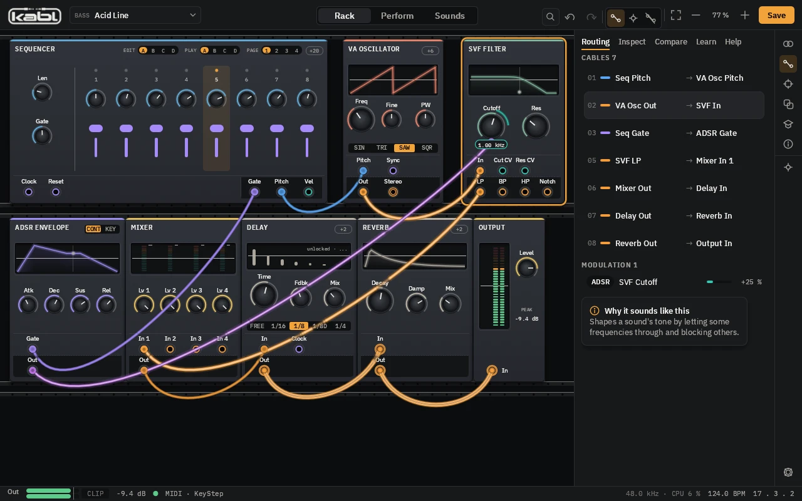
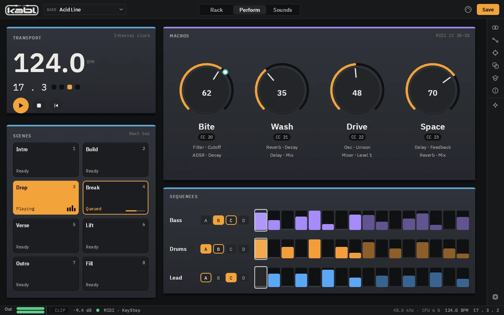
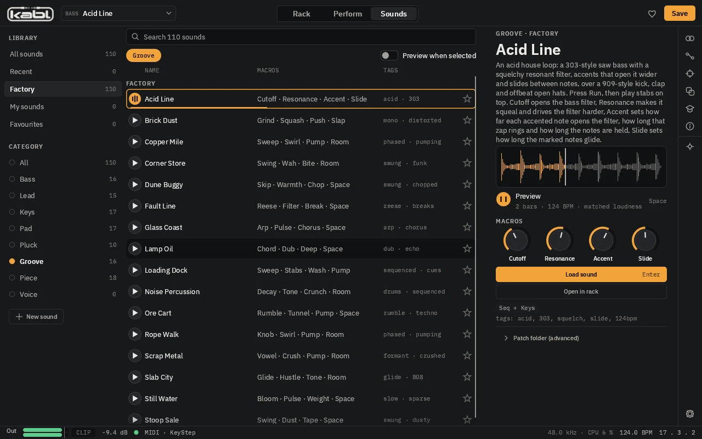

<p align="center"></p>

# kabl

A legible modular synthesizer, written in Rust. Cables are instruments, patches explain
themselves, and the sound you hear can be traced back through the patch.

kabl runs as a **standalone synthesizer** (`kabl-ui`: a rack, a Perform view and a Sounds
browser) and as a **CLAP instrument plugin** (`kabl.clap`, tested in REAPER and with the CLAP
validator). Linux is the supported platform for 1.0.

<p align="center"></p>

<p align="center"></p>

<p align="center"></p>

## What is in it

- **Modules (53 built-in kinds):** analog-style, FM (two- and six-operator) and wavetable
  oscillators; state-variable, ladder, comb and formant filters, a vocoder; ADSR, LFO, noise,
  random, sample and hold, slew; clock, clock divider, step sequencer, arpeggiator, quantizer,
  logic and comparator; kick, snare, clap, hat and tom voices and a drum grid; VCA, gain, mixer,
  pan, crossfade, ring modulator; drive, bitcrusher, chorus, phaser, flanger, delay, reverb, EQ,
  compressor, limiter; macros, cues, MIDI and audio in, output. Composite modules can be built
  from these and saved.
- **Code modules:** add your own module kinds, written in Rust (or C) with the creator SDK in
  [`sdk/`](sdk/README.md) and built with `cargo kabl`. A module is a `.kablmod` file: drop it on
  the kabl window to install it. Code runs as sandboxed WebAssembly with a CPU budget; a module
  that fails or overruns fades out alone while the rest of the synth keeps playing. A song that
  uses a code module carries its code, so it opens anywhere. The SDK is a preview: its interface
  may change before 1.0.
- **Functional cables:** a cable can carry a step pattern, a pass probability, an A/B morph
  and glide, all locked to the patch clock, and macros can drive cable parameters.
- **Factory bank:** over 100 sounds in `patches/` (installed as `share/kabl/patches`): bass,
  lead, keys, pad, pluck and groove sounds, each played from a few named macros, and self-playing pieces
  with scenes and cues. The Sounds browser searches them and previews any sound at matched
  loudness before you load it, in the app and in the plugin. Your own sounds are saved to
  `~/.local/share/kabl/sounds` and are never touched by an upgrade or an uninstall.
- **Real-time safe audio path:** no allocation or locking in the callback; the tests enforce it
  (`assert_no_alloc`).

## Install (Linux, from the tarball)

Download `kabl-<version>-linux-<arch>.tar.gz` from the Releases page, then:

```
tar -xzf kabl-*-linux-*.tar.gz
cd kabl-*-linux-*
./install.sh            # standalone + desktop entry + icons under ~/.local, plugin as ~/.clap/kabl.clap
./install.sh --uninstall
```

`./install.sh --prefix DIR --clap-dir DIR2` installs elsewhere. You can also run `bin/kabl-ui`
straight from the extracted folder without installing. Needs ALSA (`libasound2`), X11 or
Wayland with OpenGL, and `libxkbcommon-x11`.

## Run

```
kabl-ui                    # opens the sound browser
kabl-ui --size 1280x800    # smaller window
```

In a DAW, scan `~/.clap` (or the folder you chose) and load **kabl** as an instrument.
Logs are written to `~/.local/state/kabl/logs/kabl.log`; the full list of options and
environment overrides is in the tarball's `README.txt` and
[`docs/find-play-save/README.md`](docs/find-play-save/README.md).

## Build from source

Needs a current stable Rust toolchain and, on Debian or Ubuntu,
`libasound2-dev libxkbcommon-dev libdbus-1-dev`.

```
cargo run --release -p kabl-ui          # run from the checkout
cargo build --release -p kabl-clap      # target/release/libkabl_clap.so, the plugin
packaging/linux/package.sh              # the release tarball, in target/dist
cargo install --path crates/cargo-kabl  # `cargo kabl`, to build code modules (see sdk/SDK.md)
cargo test --workspace
cargo fmt --all -- --check
```

`crates/`: `core` (op log, patch state, file format, no audio dependencies), `engine` (graph
compiler, scheduler, voices), `modules` (built-in kinds and the code-module host), `cables`,
`ui` (egui rack and sound browser), `standalone` (app support for `kabl-ui`, and the `kabl`
CLI: file tools, test render), `clap` (plugin), `cargo-kabl` (the module build tool). `sdk/` is
the creator SDK (0BSD), a separate workspace. `vendor/nice-plug` is a vendored copy of the plugin
framework (ISC), see `vendor/nice-plug/STRICT-PROFILE.md`.

## Documentation

- [`docs/STATUS.md`](docs/STATUS.md): current state and what is next.
- [`docs/PRODUCT-PLAN.md`](docs/PRODUCT-PLAN.md): intent and delivery order.
- [`docs/decisions.md`](docs/decisions.md): every non-trivial choice and the alternative rejected.
- [`docs/functional-cables/README.md`](docs/functional-cables/README.md), [`docs/find-play-save/README.md`](docs/find-play-save/README.md): feature guides.
- [`sdk/SDK.md`](sdk/SDK.md): writing, building, testing and sharing a code module.
- [`docs/benchmarks.md`](docs/benchmarks.md), [`docs/eng-v1/REAPER-CODE-BENCH.md`](docs/eng-v1/REAPER-CODE-BENCH.md): measured performance.

## Licence

Source code: GPL-3.0-or-later ([`LICENSE`](LICENSE), owner and additional terms in
[`COPYRIGHT`](COPYRIGHT)). The name "kabl" and the logo are reserved
([`TRADEMARKS.md`](TRADEMARKS.md)); a fork needs its own name and says "Based on kabl". Music you
make with kabl is yours, with no conditions. Dependency licences:
[`THIRD-PARTY-NOTICES.md`](THIRD-PARTY-NOTICES.md). Fonts, wavetables, logo, patches and docs:
[`ASSET-LICENSES.md`](ASSET-LICENSES.md). Contributing: [`CONTRIBUTING.md`](CONTRIBUTING.md). Audit:
[`docs/licensing/AUDIT.md`](docs/licensing/AUDIT.md).
