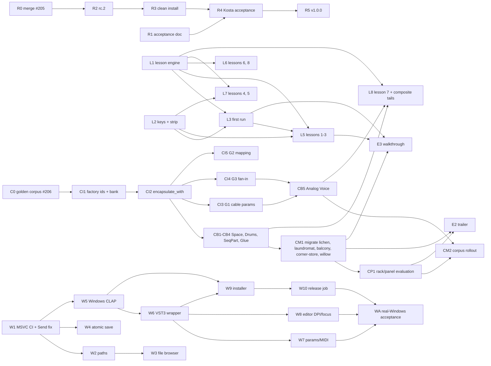

# kabl roadmap (canonical)

Date 2026-11-23, written after Kosta's product pivot ([brief](pivot/BRIEF-2026-11-23.md)). This is the one plan. Where another document disagrees, this one wins.

**Supersedes**
- `docs/overseer/HANDOVER-2026-11-21.md`, "Order to 1.0.0". Workstream 0 below carries what is left of it.
- `docs/v2/PLAN.md` on branch `ccr-1adff24f-zzq23d`. Never merged, never reviewed by Kosta. Only the parts this plan cites are kept; everything else is deferred (see "Deferred").
- `docs/ROADMAP-WOW-2026-11-13.md`. It is not on `origin/master` or any remote branch, so there was nothing to reconcile.
- The order in `docs/PLAN.md` and `docs/STATUS.md`, wherever it conflicts with this plan.
- `docs/product-research/briefs/D03.md:96-98`, only the clause that says "exactly three recipes, no curriculum engine". Owner decision D03-R.

`docs/ACCEPTANCE-V1.md` stays the 1.0 acceptance checklist. Slices R1 and L3 bring it in line with the code.

**Inputs.** Each one is copied into `docs/pivot/` so the links below resolve inside the repo:
- [first run and learning design](pivot/firstrun-learning-design.md) (slices L1 to L9, decisions D1 to D7);
- [corpus manifest](pivot/corpus-manifest.md) and its [CSV](pivot/corpus-manifest.csv);
- [composite catalogue](pivot/composite-catalogue.md) (candidates C1 to C8, gaps G1 to G9);
- [Windows/VST3 feasibility](pivot/windows-vst3-feasibility.md) (slices W1 to W11).

The screenshots that the learning report cites are in `.claude/tmp/coordinator/reports/firstrun/`. They are scratch files and are not committed.

## Status legend

| mark | meaning |
|---|---|
| **DONE** | done and verified: merged, with the evidence named |
| **WORK** | exists, needs work |
| **NEW** | new work |
| **DEP** | dependent: waits on the listed items |
| **OWNER** | a Kosta decision is needed first |
| **NOW** | can start now: no open dependency and no open decision |

Effort is relative and per slice. **S** is about one bounded PR of a day or less. **M** is one PR of several days with real tests and captures. **L** spans several PRs or has an unknown external factor. These sizes are not promises. Each one states its main assumption.

## Order

The brief sets this order: roadmap; first-run and learning foundation; composite candidates; the first composites; migrate representative patches, then the corpus; learning progression on real composites; Windows standalone and VST3; promo; macOS later.

Release 1.0 on Linux finishes first and blocks nothing in A to D.

In practice the streams overlap. A/B and C share no files until L8. The Windows path, filesystem and CI slices (W1 to W5) touch different files from A, B and C, so they can run beside them, within the three-build limit. W6 and later (VST3, editor, installer) wait until A1 is in place, because the editor work should see the first-run UI it has to host.

---

## Workstream 0: release 1.0 (Linux x86_64, CLAP + standalone)

**Objective.** Tag `v1.0.0` from a verified release candidate that Kosta has accepted.

**Scope.** Release mechanics and acceptance fixes only. No new features. Code: `.github/workflows/release.yml`, `packaging/linux/package.sh`, `docs/ACCEPTANCE-V1.md`.

**Deliverables.** The `v1.0.0-rc.2` tag with a green release run; a clean-profile install report; an acceptance checklist that matches 1.0; the `v1.0.0` tag and its Releases page.

**State**
- **DONE**: #196 (release 1.0.0: workspace 1.0.0, CHANGELOG, `release.yml`) merged as `89d9c1be`.
- **DONE**: #204 (triangle polyBLAMP) merged.
- **DONE**: #198 and #199 merged.
- **WORK**: the `v1.0.0-rc.1` release run failed. `release.yml` runs `cargo test --workspace --release`, but PR CI builds only debug, so a release-only test compile error got through.
- **WORK**: fix PR #205 ("assert_no_alloc disable_release") is green and was reviewed clean. It waits for Kosta's merge.

**Remaining, in order**

| id | item | status | effort |
|---|---|---|---|
| R0 | Kosta merges #205 | OWNER (merge) | - |
| R1 | Bring `docs/ACCEPTANCE-V1.md` in line with 1.0 reality: §1 has no overlay to accept, and Pluck line plays itself rather than on a key press; §2 has the output device in the status-bar dropdown and no buffer-size UI (`--frames` only); drop the stale **[PR]** markers for #171, #172, #187 and #188, which are merged. Docs only | NOW | S |
| R2 | Tag `v1.0.0-rc.2` (through `gh api` git/refs) and watch the release run | DEP R0 | S |
| R3 | Install the rc.2 tarball on a clean profile (fresh `HOME`/`XDG_*` under scratch): standalone launch, CLAP scan in REAPER, first sound | DEP R2 | S |
| R4 | Kosta runs `docs/ACCEPTANCE-V1.md` on rc.2 | OWNER, DEP R1, R3 | - |
| R5 | Fix findings in bounded PRs; tag `v1.0.0` | DEP R4 | S-M, depends on findings |

**Acceptance.** The release run is green on the tag. The tarball installs on a clean profile. Kosta's verdict line reads "Accept".

**Risks**
- More release-only failures. Release CI is the only place `--release` tests run. Mitigation: R2 runs the full release workflow before anything else.
- If the acid-line decision (OD-1) is "fix before 1.0", it adds one preset PR to R5.

---

## Workstream A: first-run experience

**Objective.** A newcomer on a fresh profile hears sound within 2 s. They play a note within 30 s, with no MIDI controller, and they find, change and save a sound within 5 minutes. Standalone and plugin share one system. Nothing forces itself on the user or blocks normal use.

**Scope.** Standalone and CLAP (and later VST3) first open. There is one onboarding path: the first run is lesson 00 of the Workstream B engine, and `tour.rs` is retired. Details: [design §2](pivot/firstrun-learning-design.md).

**Current state (WORK)**
- The start patch Pluck line exists and plays at once (`crates/ui/src/first_run.rs:46-183`, `crates/modules/src/builtins/clock.rs:136`).
- The four-step tour exists (`tour.rs`, 534 lines).
- The library and its previews work, and so do the Perform macro destinations (`perform_view.rs:1508-1545`) and Explain (`explain.rs`).

Blockers found in a real fresh-profile run:
- no way to play a keyboard sound without MIDI (85 of 129 sounds are keyboard sounds);
- Sounds opens on top of the playing patch;
- three conflicting toasts on load;
- the tour's scrim blocks input, and its text is written for Pluck line but applied to any patch;
- Pluck line has no macros;
- the audio device and MIDI choice are not remembered (`style/load.rs:562-581`).

The plugin shows no first-run card at all (`crates/clap/src/lib.rs:853-858`).

**Deliverables.** Computer-keyboard notes and an on-screen key strip (L2). The Start card and the Sound-check strip, run as lesson 00 (L3). A macro reveal (L4).

**Slices**

| id | slice | status | effort | depends |
|---|---|---|---|---|
| L2 | Play without a controller: computer-key notes (A-row, W-row, Z/X octave, focus guard), a collapsible on-screen key strip in `kabl_ui`, and a UI note ring into the clap audio path; all-notes-off on focus loss | NOW (D6 shapes the default, not the build) | M: input plumbing in two builds, plus a stuck-note test matrix | - |
| L3 | First run on the lesson engine: lesson 00 TOML; start in the Rack with Pluck line playing; a Start card with no scrim; an anchor ring that does not capture input; delete `tour.rs`; a Sound-check strip that remembers the output device and MIDI input (`style::Prefs`); a card on the first plugin instance; Pluck line macros if D7 = A; update `ACCEPTANCE-V1.md` §1 | DEP L1, L2; OWNER D1, D2, D3, D7 | M | L1, L2 |
| L4 | Macro reveal: while a macro turns, the card lines show the module number and signed depth ("Ladder #7 Cutoff +40 %"), and the target knob rings in the rack pulse (`explain::destinations`, `explain.rs:319`) | NOW | S: same graph data, UI only | - |

**Acceptance.** As in [design §5](pivot/firstrun-learning-design.md), and in short:
- On a fresh profile there is sound within 2 s.
- Every Start-card action works, in any order.
- Esc or "Not now" never brings the card back.
- Nothing is blocked while the card shows.
- The device and MIDI choice are remembered.
- The plugin shows the card once and stays silent until it gets MIDI.
- No stuck notes. Typing in a text field never plays a note.
- Evidence is a fresh-profile walkthrough capture, in standalone and in REAPER, plus listening clips on `kabl_agents`.

**Risks and open questions**
- Keyboard focus inside hosts: Live shortcuts against the key input (see W8).
- D7 = A changes a factory patch. It has to render bit-identical at rest, checked with `first_run::render` (`first_run.rs:196`).
- The plugin note ring has to stay RT-safe: no allocation, no lock on the audio thread.

---

## Workstream B: learning path

**Objective.** One coherent learning system across eight stages, plus lesson 00. Lessons are taught through real patches and the real UI. Each lesson ends in a useful patch the user saved. Lessons are optional and revisitable and never lock anything.

**Scope.** The lesson engine in `crates/ui/src/lessons/`, lesson files in `lessons/`, teaching patches in `patches/lessons/`, the Learn tab, and one automation-lane hook in `crates/clap`. No factory sound changes.

**Deliverables.** The engine with the three recipes migrated (L1); lessons 1 to 8 as TOML with their teaching patches (L5 to L8); the anchor-resolution guard test; walkthrough captures and listening clips per lesson.

**Architecture.** In three lines, from [design §3](pivot/firstrun-learning-design.md):
1. A lesson is a TOML file (steps, target patch, anchors, completion predicates, listening prompts), embedded in the binary.
2. One runner in `kabl_ui` evaluates a closed set of predicates each frame against the real `PatchState`, the op log and `UiState`. It rings anchors from the existing `UiState::hits` registry (`lib.rs:225-228`) and never edits the patch.
3. Progress lives in `library.json` and is shared by the standalone and the plugin.

`recipes.rs` and `tour.rs` are replaced. The three D03 recipes become steps of lessons 2, 3 and 5.

**Current state (WORK)**
- `recipes.rs` exists: three hard-coded recipes, Next only, no completion detection.
- `help.rs`, `explain.rs`, `inspect.rs` and `compare.rs` exist.
- `ModuleInfo.lesson` is unused (`crates/modules/src/info.rs:183,194`).
- The `lessons/` scaffold is gone.

**Lesson outline.** See the [table in design §4](pivot/firstrun-learning-design.md):

| lesson | topic | can be built |
|---|---|---|
| 00 | start here | now |
| 1 | find and play | now |
| 2 | change sounds | now |
| 3 | signal flow | now |
| 4 | build a voice | primitives now; composite tail later |
| 5 | movement | primitives now; composite tail later |
| 6 | perform | now |
| 7 | reusable modules | mechanics now; content needs composites |
| 8 | kabl in a DAW | CLAP and REAPER now; VST3 and Live after D |

**Slices**

| id | slice | status | effort | depends |
|---|---|---|---|---|
| L1 | Lesson engine core with the recipes migrated: `crates/ui/src/lessons/{mod,run,panel}.rs`; the TOML format; the predicate enum (the recipes' predicates plus `opened`, `param_moved`, `route`, `inspecting`, `compare_restored`); `lessons/` embedded by `crates/ui/build.rs`; progress in `library::Prefs`; the Learn tab as hub; delete `recipes.rs`; port the recipe checks in `tests/signal_inspection.rs:725` | In flight (builder running, branch `claude/lesson-engine`) | M: well-bounded; the new code is the runner | - |
| L5 | Lessons 1, 2, 3 (content, teaching patches under `patches/lessons/` from test generators, the remaining predicates) | DEP | M | L1, L3 (L2 for lesson 1) |
| L6 | Lessons 6 and 8; the automation-lane hook in `crates/clap` (`lib.rs:646-660`) | DEP | M | L1 |
| L7 | Lessons 4 and 5 on primitives; bindings by `added_in_step` | DEP; OWNER D5 | M | L1, L2 |
| L8 | Lesson 7, plus the composite tails of lessons 4 and 5 | DEP | M-L: content depends on the composite quality reached | L1, CB3, CB5 (Analog Voice), C-insert from the factory bank (CI1) |

**Acceptance (all lessons)**
- A newcomer-style walkthrough on a fresh profile runs end to end and ends with a saved user sound.
- A headless guard test asserts that every step's anchor resolves after its `do` actions. A renamed hit key then fails CI, not a user.
- Progress survives a restart and is shared with the plugin.
- Listening prompts are checked by ear, with clips at each step for Kosta.
- L1 specifically: the three recipes behave as they do today (same patches, Show, Back, Inspect, Compare, test note) and advance on their checks. No patch or sound changes.

**Risks and open questions**
- Predicate creep: the closed enum must not turn into an expression language.
- Hits-key stability: covered by the guard test.
- L8 sits at the end of the C chain: it needs the Analog Voice, which needs G1 and G3.
- D4 = B would make the lesson format a public, versioned contract.

---

## Workstream C: composites across the whole corpus

**Objective.** Make complex patches legible through a coherent library of reusable musical building blocks, discovered from the whole corpus, with no hand-simplification. Behaviour is preserved exactly. Any sonic change is Kosta's call.

**Scope.** All 129 browser patches and the hidden demos, through their generators in `tools/examples/presets_*.rs`; the composite model and encapsulate code (`crates/core/src/composite.rs`, `crates/ui/src/composites.rs`); a factory composite bank. Learning patches stay flat. Fixtures and dev-only assets are out of scope.

**Deliverables.** Corpus golden hashes (C0); the infrastructure gaps closed (CI1 to CI5); five factory composites (CB1 to CB5); migrated representative patches, then the corpus (CM1, CM2); rack and panel captures for Kosta (CP1).

**Evidence base (DONE)**
- The corpus manifest covers all 160 assets: 129 in the Sounds browser, 19 hidden engine demos, 12 `docs/` items. It classifies fixtures, promo and dev-only assets separately.
- The ranked catalogue was mined from the graphs and cross-checked against the generator helpers. See [manifest](pivot/corpus-manifest.md) and [catalogue](pivot/composite-catalogue.md).
- No shipped patch uses a composite today.

**Ranked candidates** (catalogue ids; reach = browser patches):

| candidate | name | reach | first-batch fit |
|---|---|---|---|
| C1 | Analog Voice | 105 | needs G1 and G3 (40 patches blocked) |
| C2 | Space (echo + room), with C6 Space Return nested | 97 | yes |
| C3 | Sequenced Part (families A and B; family C stays flat) | 32 | yes |
| C4 | Drum Kit | 23 | yes (0 blocked) |
| C5 | Glue Bus | 16 | yes |
| C7 | Generative Line | Lichen-specific | later, G1 |
| C8 | Tempo Pump | 5 | only if wanted for teaching |

Explicitly not composites: the `clock.div` cascade, a single `lfo`, the formant mouth, the acid glide, and the macro and cues hubs.

**Existing infrastructure (WORK).** D09 composites and D10 panels exist:
- model in `crates/core/src/composite.rs:9-37`;
- encapsulate in `crates/ui/src/composites.rs:155-239`;
- panels in `crates/core/src/panel.rs`.

D10 panel UX is "changes requested" (`docs/panel-authoring/design.md:3`). The DSP compiles the flat graph, so grouping is metadata only. An exact-PCM grouped-vs-flat test exists (`crates/ui/tests/composites.rs:193`).

**Gaps to close.** Only real gaps, from the catalogue's gaps table:
- G4/G5: stable factory definition ids and a factory composite bank; a curated `encapsulate_with` for generators.
- G1: expose a cable param, and let cable-param routes cross the boundary.
- G3: fan-in, so one public input reaches several targets.
- G2: presentation mapping (musical range, unit, default, multi-target). It must never clamp stored values.
- G6: pattern widgets on panels. Deferred: patterns are edited through Inspect internals.
- G8 and G9: watch only.

**Slices**

| id | slice | status | effort | depends |
|---|---|---|---|---|
| C0 | Golden render hashes for the whole Sounds corpus (129 patches), recorded on the base commit before any migration (G7). Each migration PR must then pass `cargo test -p kabl-engine --test golden_renders` unchanged | WORK: **PR #206 in review** | S | - |
| CI1 | G4: deterministic factory definition ids (for example `kabl.space` v1) and a read-only factory `composites/` bank packed like `patches/`, for Insert. Instances embed and never auto-update | OWNER (OD-C2, id scheme) | M | C0 |
| CI2 | G5: `encapsulate_with(definition, exposures{target,label,mapping}, panel)` so the generators in `tools/examples/presets_*.rs` emit stable logs; migration appends `SetComposite` after existing ops and keeps leaf and cable ids and order | DEP | M | CI1 |
| CB1 | Space composite (C2) plus nested Space Return (C6); interface as in the catalogue's C2 section; standalone test plus a test inside a parent | DEP; OWNER (OD-C interface) | M | CI1, CI2 |
| CB2 | Drum Kit (C4) | DEP; OWNER (OD-C) | M | CI1, CI2 |
| CB3 | Sequenced Part (C3, families A and B) | DEP; OWNER (OD-C) | M | CI1, CI2 |
| CB4 | Glue Bus (C5) | DEP; OWNER (OD-C) | S-M | CI1, CI2 |
| CM1 | Migrate the representative patches in the generators: lichen (validation case), laundromat, balcony, corner-store, willow. Proof: structural identity (only `composites` added), golden hashes unchanged, `render_hash` 20 s before and after, scripted clip PCM before and after, a Lichen cue-firing render, SoundState save and recall | DEP | L: five generators, cue and macro proofs | CB1-CB4 |
| CP1 | Rack and panel evaluation on the migrated patches: real captures of Lichen at top level (17 objects instead of 76 is the catalogue's estimate with G1), and panel faces for the four blocks. Kosta judges on captures | DEP; OWNER (taste) | S-M | CM1 |
| CI3 | G1: `Exposure.target = CableParam` when the cable is internal, as a control and as a modulation port; encapsulate exposes instead of refusing | DEP | M | CI2 |
| CI4 | G3: fan-in. An `Exposure` holds a list of targets for inputs; encapsulate groups crossings by their outside source; no thru modules | DEP | M | CI2 |
| CB5 | Analog Voice (C1) over 105 patches; regression case cinder-block | DEP; OWNER (OD-C) | M-L | CI3, CI4 |
| CI5 | G2: presentation mapping on `Exposure` (display range, unit, curve, scaled multi-target) through `param_editor`; never clamps stored values (acid-line `makeup_db -2`, reverb `decay_s` 0.25) | DEP | M | CI2 |
| CM2 | Corpus rollout, one generator per PR (bass_lead, groove, pad, voice, piece, pilot, keys_pluck), with the CM1 proofs; learning patches stay flat (init-keyboard, reference, recipes/*, sequence, echo, interlocking) | DEP | L: about 7 PRs | CM1, CP1, and CB5 for voice-heavy generators |

**Acceptance**
- Every migrated patch replays to identical `modules`, `cables`, `labels` and `tables`, with only `composites` added.
- Corpus golden hashes and transport hashes are unchanged.
- Cue references, MIDI mappings, host automation slots and SoundState recall are unchanged.
- Each composite is useful on its own: inserted from the factory bank into an empty rack, it plays.
- Kosta accepts the interfaces (OD-C) and the rack captures (CP1).

**Risks and open questions**
- **File format.** G1 may fit into the existing `PortRef` serialization. G2 and G3 change the `Exposure` record. Whether that is a schema bump, and whether 1.0 must open such files, is an on-disk-format decision for Kosta (OD-C3). It interacts with the v2 plan's "migration chain" item: `format.rs` accepts only schema 8.
- A generator regeneration that rebuilds patches instead of appending ops breaks cable-id order and therefore PCM. CI2 must forbid it.
- If the D10 panel "changes requested" stays open, CP1 can only evaluate rack cards, not custom faces.
- Lichen's morph routes and its probability mixer stay bespoke by design.
- The catalogue's numbers are measured, but "standalone usefulness" is the auditor's 1-3 judgement.

---

## Workstream D: Windows standalone and VST3

**Objective.** Windows standalone and a Windows VST3 (plus a Windows CLAP) on the same engine and patch model. Accepted in Ableton Live first and REAPER second, on real Windows. Linux stays first-class: Linux CI is unchanged and Windows jobs are only added.

**Scope.** Platform fixes in `crates/ui` and `crates/standalone`, the CLAP crate's Windows build, a clap-wrapper VST3 build under `packaging/windows/`, Windows CI and release jobs, and an installer. macOS and AU are out of scope.

**Deliverables.** A green Windows CI job; `kabl.clap` and `kabl.vst3` that pass their validators; a Windows standalone; an Inno Setup installer and zip on the Releases page; a real-Windows acceptance report for Live and REAPER (WA).

**Route.** clap-wrapper (MIT) around the existing CLAP, producing a clap-first single-file `.vst3`. Reasons:
- kabl's host behaviour lives at raw CLAP level (`crates/clap/src/state_bridge.rs`);
- nice-plug's own VST3 export uses the generic state loader that kabl bypasses.

Fallback to nice-plug's export only if Live fails in a way upstream will not fix. This agrees with v2 PLAN §5.5 (wrapper route, no second code path). Host params are already VST3-safe: a fixed list of 18 with stable 31-bit ids.

**Current state**
- **WORK**: the workspace cross-compiles for `x86_64-pc-windows-gnu`. There is exactly one real compile error: the RT priority handle is not `Send` (`crates/ui/src/app/callback.rs:64,81-99`).
- **WORK**: under Wine, the standalone self-test renders and the CLAP factory lists kabl. A thin wrapper exposes one class `bda9c239b42389589c969403a7b9d23e`.
- None of this is Windows support. Nothing has run in a real Windows host.
- Platform assumptions to fix are listed in the [feasibility table](pivot/windows-vst3-feasibility.md): paths `library.rs:250-294`, `style/load.rs:600-608`, `applog.rs:136-153`; file browser `filebrowser.rs:920-922`; atomic save `format.rs:395-410`.

**Slices**

| id | slice | status | effort | depends |
|---|---|---|---|---|
| W1 | RT handle `Send` fix; a `windows-latest` MSVC CI job (build ui, clap and standalone; `cargo test`; Linux-only tests skipped) | OWNER (OD-W9, toolchain) | S | - |
| W2 | Platform paths in one place (`%APPDATA%`, `%LOCALAPPDATA%`), Linux paths unchanged | DEP | S | W1 |
| W3 | File browser: profile home, drive roots, breadcrumbs | DEP | S | W2 |
| W4 | Atomic save: retry, or `ReplaceFileW` | DEP | S | W1 |
| W5 | Windows CLAP in CI plus clap-validator | DEP | S | W1 |
| W6 | VST3 through clap-wrapper (`packaging/windows/vst3/CMakeLists.txt`, pinned clap-wrapper and VST3 SDK, clap-first `kabl.vst3`, Steinberg validator in CI); C++ deps listed by hand in THIRD-PARTY-NOTICES | DEP; OWNER (OD-W5 class id) | M: CMake plus CI time 5-10 min | W5 |
| W7 | VST3 param and MIDI fit (flags, groups, CC mapping) | DEP | S-M | W6 |
| W8 | Editor: per-monitor DPI manifest, scaling, resize, Live keyboard focus, reopen leak check | DEP | M: baseview windowing hazards are the main schedule risk | W6 |
| W9 | Inno Setup installer: Program Files, VST3 and CLAP common folders, Start menu; the uninstaller keeps user data | DEP; OWNER (OD-W4) | M | W5, W6 |
| W10 | Release job: installer, zip, SHA256SUMS, optional signing | DEP; OWNER (OD-W3) | S | W9 |
| W11 | Optional: Windows theme, idle priority, ASIO | OWNER (OD-W8) | S each | W1 |
| WA | Real-Windows acceptance pass (Kosta, or an agent with remote access): the 9-point list in the feasibility report (discovery, playback across buffers and rates, MIDI via Live, automation surviving edits, state recall including Linux-to-Windows, editor x20 and DPI, 8+ instances, clean-VM install and uninstall, AppData paths with non-ASCII names) | DEP; OWNER (OD-W1, OD-W2) | L: needs a machine and a Live licence | W7-W10 |

Order: W1; W2-W4 beside W5; W6; W7 and W8; W9 and W10; WA.

**Acceptance.** WA passes in Live and in REAPER on real Windows: playback, MIDI, automation, state recall, editor lifecycle and clean install. Linux CI stays green and unchanged. A cross-compile alone does not count.

**Risks and open questions**
- Live VST3 quirks: CC mapping, the param thread, keyboard focus.
- OpenGL on VMs and older iGPUs. A wgpu fallback may be needed.
- The RT audit has to be redone for WASAPI.
- SmartScreen warnings while unsigned.
- cpal is linked into the plugin binary (it imports mmdevapi): harmless, but worth trimming.
- The learning progress file moves with W2. Lessons must use the same path helper.

---

## Workstream E: promotion

**Objective.** Two separate assets that follow the product work and must not delay it:
- a trailer: atmospheric, fast, sound and identity, broad palette, building to big moments, Lichen as the flagship;
- a walkthrough: first run, find a sound, change it, understand its signal path, use composites, perform.

**Scope.** Promo scripts, storyboards and renders only. Promo work never changes product code or factory sounds. Code: `tools/examples/promo_render.rs`, `docs/promo/build_animatic.py`, `docs/promo/STORYBOARD-V2.md` (all on `claude/promo-v2`); `docs/promo/lichen-plus.kabl`.

**Deliverables.** A trailer render (E2) and a walkthrough recording (E3), each with its audio mix, for Kosta's approval.

**Current state.** WORK: promo v2 on branch `claude/promo-v2` (#203): `STORYBOARD-V2.md`, `build_animatic.py`, `promo_render.rs`, an audio animatic, and a captions pass in flight. It is useful work, but neither approved nor final. The earlier Kosta questions (half-bar cuts, the Loading Dock pulse, a Pad flash) are still open. Promo v1 (#197) is merged and holds the lichen-plus patch and the take scripts.

**Slices**

| id | slice | status | effort | depends |
|---|---|---|---|---|
| E1 | Finish the #203 captions pass and park it as a draft. No video recording until E2 | WORK, in flight | S | - |
| E2 | Trailer: redo the Lichen sequence on the migrated patch (high-level patch, inspect a composite, change a control, back to the music; no huge flat rack). Lichen Plus's "Disco" becomes a parent with four C3 children | DEP; OWNER (taste on clips) | M | CM1, CP1 |
| E3 | Walkthrough: record lesson 00 and lessons 1-3 through the real app, plus composites and Perform (learning report L9) | DEP | S-M | L3, L5, CM1 |

**Acceptance.** Kosta approves both on real renders, not on storyboards.

**Risks**
- Misrepresenting the build: every shot must come from the shipped app and patches, with no mocked UI or features that are not merged.
- Timing against the product: recording before composites and lessons land means recording twice. E2 and E3 wait for their dependencies.
- Taste rounds: each round needs Kosta's listen and viewing. Expect several, and keep them on short clips rather than full cuts.

---

## Deferred, and what is kept from older plans

- **macOS and AU.** Deferred by the brief. Plan it after WA. The v2 plan's notes stay as reference: Apple Developer fee, the cpal CoreAudio floor, the baseview teardown hazards.
- **v2 PLAN items not adopted now:**
  - A1 polyphony, MPE and microtuning; A2 and A3 DSP families. These are unrelated DSP work, which the brief forbids during the pivot.
  - The Linux launch campaign, `kabl render` and `kabl modules --json`, community setup, funding, the AV track.
  - These remain proposals for Kosta. None is rejected.
- **v2 PLAN items carried in:**
  - the wrapper route for VST3 (§5.5);
  - the migration-chain concern (§5.4), now attached to OD-C3;
  - the signing research (§3.5), now attached to OD-W3.
- **Overseer handover 11-21, carried in:** the order to 1.0 (as Workstream 0); the decisions of 11-22, which stay in force (Linux x86_64 CLAP only for 1.0, SDK stays 0.1 preview, release notes from CHANGELOG).
- **Corpus hygiene, found by the audit:**
  - `patches/crowded` is a layout fixture that ships in the browser as a "Study" (OD-3).
  - Vestigial unity mixers in the pieces (Lichen #54, #56) may be removed only with a render check. They are not on the plan.

---

## Dependency graph

## Immediately startable

No open dependency and no open owner decision. Respect the limit of three cargo builds at once.
1. **L2** play without a controller. D6 only sets the default; the slice can make it a pref.
2. **L4** macro reveal.
3. **R1** acceptance checklist alignment. Docs only, no build.

Already in flight (not to be started again):
- **L1** lesson engine core: builder running on `claude/lesson-engine`.
- **C0** golden corpus: PR #206, in review.
- **E1** promo captions pass on `claude/promo-v2` (#203). No cargo build.

Owner-gated, startable as soon as their decision lands:
- W1 (OD-W9, toolchain: native MSVC on `windows-latest`). It needs no Windows machine;
- CI1 (OD-C2, id scheme; also needs C0 merged);
- L3 (D1, D2, D3, D7; also needs L1 and L2);
- L7 (D5).

---

## Owner decisions (all OPEN)

Each decision lists its alternatives, its consequences and a recommendation. The evidence is in the linked report. Answering with the decision's id and a letter is enough.

### First run and learning ([design §6](pivot/firstrun-learning-design.md))

**D1. Where the first launch opens** (blocks L3)
- Options:
  - A: the Rack, with Pluck line playing and the Start card.
  - B: Sounds open (today, `startup.rs:236`).
  - C: a silent rack until the user presses Start.
- Consequence: with A there is sound in under 2 s and the user sees the instrument, but it plays at launch. Stop is on the card.
- **Recommend A.**

**D2. The Start card and lessons in the plugin** (blocks L3)
- Options:
  - A: once ever, with progress shared with the standalone.
  - B: never in the plugin.
  - C: only from Learn.
- Evidence: the plugin runs the same UI. A Windows user may install only the VST3 (but see "Inconsistencies").
- **Recommend A.** The plugin never makes sound by itself.

**D3. Preview when selected** (blocks L3)
- Options:
  - A: on for everyone.
  - B: on only during lesson steps.
  - C: off (today, `library.rs:153`).
- Consequence: A breaks the explicit rule "browsing never makes sound" (`browser.rs:9`).
- **Recommend B now**, and revisit A after hands-on use.

**D4. Where lessons live** (not blocking)
- Options:
  - A: embedded in the binary, factory only.
  - B: also loaded from the user dir (community lessons).
- Consequence: B costs about a day more and makes the TOML a public, versioned format.
- **Recommend A.** The format allows B later.

**D5. Lesson order** (blocks L7)
- Options:
  - A: lessons 4 and 5 on primitives first, with composite tails added later.
  - B: hold lessons 4 and 5 until composites exist.
- Consequence: B delays half the curriculum behind the whole C chain.
- **Recommend A.** Building a voice from parts is what makes a composite understandable afterwards.

**D6. Computer-keyboard notes** (shapes L2)
- Options:
  - A: on by default in standalone, A-row layout (Ableton-like), key strip hidden until asked.
  - B: off until enabled.
- Evidence: without a controller, no keyboard sound can be played today.
- **Recommend A.**

**D7. Pluck line gets macros** (blocks L3; changes a factory patch)
- Options:
  - A: add Brightness and Space macros, bit-identical at rest, proved by an offline render comparison.
  - B: keep Pluck line as it is; lesson 00 loads a preset for "Change it".
  - C: pick a different start patch.
- **Recommend A.** The first change then happens on the sound the user already hears.

**D03-R. Reverse D03's "exactly three recipes, no curriculum engine" clause** (`docs/product-research/briefs/D03.md:96-98`) (blocks L1 merge)
- Options:
  - A: reverse only that clause. D03's other rules stay: optional, no unlocks, no scores, view-only, explicit targets.
  - B: keep D03 and grow the recipes ad hoc.
- Consequence: B contradicts the brief's "one coherent learning system".
- **Recommend A.** The brief already implies it; this records it.

### Factory sounds

**OD-1. Acid Line space mix values** (`patches/presets/acid-line`, source `tools/examples/presets_groove.rs:2812,2821`)
- The problem: delay `mix=0.16` and reverb `mix=0.08` are stored on 0-100 % params (`crates/modules/src/builtins/delay.rs:72`), so the tail is close to inaudible. Every other preset uses 5-38.
- A related stored value: the glue compressor `makeup_db = -2`, below the declared 0-24 range.
- Options:
  - A: fix to the probably intended 16 % and 8 %. This is a sonic change; Kosta listens to before and after clips.
  - B: keep as shipped and record it as intended.
  - C: fix after 1.0, in 1.0.x.
- Consequence: A or C changes the golden hash for acid-line, after C0, as an explicit and reviewed hash update.
- **Recommend A for 1.0 if Kosta's listen agrees**, otherwise C. `makeup_db` is left alone either way: it is audible, so it is not a slip.

**OD-3. `patches/crowded` in the Sounds browser**
- The problem: it is a layout fixture written by `crates/ui/tests/interaction.rs:1225` and listed as a "Study".
- Options:
  - A: move it out of `patches/` into a test fixture directory.
  - B: keep it.
- **Recommend A**, after 1.0. It is not a regression, so it does not block the tag.

### Composites ([catalogue](pivot/composite-catalogue.md))

**OD-C. Approval of the first-batch interfaces** (blocks CB1-CB4 merge, and CB5 later)
- The interfaces are Space, Drum Kit, Sequenced Part and Glue Bus, as tabled in the catalogue: control names, defaults, ranges, ports.
- Options:
  - A: approve them as proposed.
  - B: approve with renames or cuts.
  - C: Kosta judges first on CP1-style captures of one prototype (Space).
- Consequence: a published factory definition is immutable (D09 semantics). Changing an interface later means a v2 definition and old instances keep v1.
- **Recommend C, then A.** Taste is judged on captures; Space is the smallest and most widely used.

**OD-C2. Factory definition id scheme (G4)**
- Options:
  - A: readable ids such as `kabl.space`, with integer versions.
  - B: UUID-style ids.
- Consequence: ids are permanent once a shipped patch embeds them.
- **Recommend A.**

**OD-C3. File-format impact of G2 and G3** (and possibly G1)
- Options:
  - A: bump the schema and add a migration step. The v2 plan's migration chain lands first.
  - B: encode the extensions so that a 1.0 reader ignores them and loses only the presentation.
  - C: defer G2. Do G3 only if it fits without a bump.
- Consequence: A means 1.0 cannot open the migrated patches, while B keeps them opening, flat.
- **Recommend:** the builder of CI3 and CI4 first reports whether a bump is needed. A is the default if it is, because "old songs always open" is about new readers.

### Windows and VST3 ([feasibility](pivot/windows-vst3-feasibility.md))

**OD-W1. Test machine** (blocks WA)
- Options:
  - A: a physical Windows PC for acceptance, plus a VM snapshot for clean-install tests.
  - B: a VM only.
  - C: no machine for agents; Kosta runs the 9-point list by hand.
- Consequences:
  - A covers real GPU drivers, DPI and audio hardware. The VM snapshot gives repeatable clean installs.
  - B is cheapest, but the OpenGL editor is a known risk on VMs, so editor and DPI results would not count.
  - C puts every Windows round trip on Kosta's time.
- **Recommend A**, with remote access for agents or Kosta running the checklist.

**OD-W2. Ableton Live licence** (blocks WA)
- Options:
  - A: a trial during development, and a licence bought before the release gate.
  - B: Live Lite.
  - C: REAPER only.
- Consequences:
  - A: the trial is time-limited, so it has to be timed for the acceptance window.
  - B: Lite's track limit cuts the 8+ instance test.
  - C: Live is the primary acceptance host in the brief, and it has no CLAP support, so it fails the brief.
- The REAPER evaluation is free either way.
- **Recommend A.**

**OD-W3. Code signing.**
- Options:
  - A: unsigned beta first.
  - B: SignPath Foundation (free, the Foundation is the named publisher).
  - C: Azure Trusted Signing (about 10 USD a month).
  - D: an OV certificate (about 200-400 USD a year); Certum Open Source at about 69 EUR is a cheaper variant.
  - EV is not worth it.
- **The reports conflict here; see "Inconsistencies".**
- **Recommend:** A, then apply to B. Fall back to D. Use C only if eligibility is confirmed.

**OD-W4. Installer** (blocks W9)
- Options:
  - A: Inno Setup plus a zip.
  - B: MSI through WiX.
  - C: a zip only, with manual copying.
- Consequences:
  - A: one script installs to Program Files and the VST3 and CLAP common folders, adds Start menu entries, and gives an uninstaller that keeps user data. It is the common choice for free plugins.
  - B: heavier to author; mainly useful for managed enterprise deployment.
  - C: users have to find the right folders themselves, which fails the brief's "clean install".
- **Recommend A.**

**OD-W5. Freeze the VST3 class id** (blocks W6 release)
- The id is `bda9c239b42389589c969403a7b9d23e`, derived from `dev.stcksmsh.kabl` by clap-wrapper.
- Options:
  - A: freeze this id at W6.
  - B: choose a new id before the first release.
- Consequence: once a release ships, a changed id means hosts treat kabl as a different plugin and every saved project loses it. B is free only before the first Windows release.
- **Recommend A.**

**OD-W6. VST logo**
- Options:
  - A: no logo.
  - B: use the VST compatible logo, following Steinberg's trademark rules.
- Consequence: B adds a usage-guidelines check to the release, for a small marketing gain. The VST3 SDK licence (MIT) does not require the logo.
- **Recommend A** for the first release.

**OD-W7. Ship a Windows CLAP**
- Options:
  - A: ship `kabl.clap` next to `kabl.vst3`.
  - B: VST3 only.
- Consequences:
  - A: REAPER and Bitwig load the CLAP natively, the same format as on Linux, so Linux projects carry over most directly.
  - B is not really possible: the clap-first `kabl.vst3` loads `kabl.clap` from the CLAP common folder, so the file ships either way and B only hides it.
- **Recommend A.**

**OD-W8. ASIO in v1**
- Options:
  - A: WASAPI only (cpal default), with ASIO later as W11 on request.
  - B: ASIO in the first Windows release.
- Consequences:
  - A: no extra SDK. In the plugin, the host owns the driver, so ASIO matters only for the standalone.
  - B: adds the Steinberg ASIO SDK to the build and a licence review, plus a second standalone audio path to test.
- **Recommend A.**

**OD-W9. Toolchain.**
- Options:
  - A: native MSVC on `windows-latest`.
  - B: cargo-xwin cross from Linux, which means accepting Microsoft's CRT and SDK licence.
  - C: MinGW. It works, but the `.vst3` then depends on `libc++` and `libunwind` DLLs.
- **Recommend A.**

---

## Inconsistencies between the inputs

1. **Signing.**
   - The Windows report recommends "Azure Trusted Signing (~10 USD/month) if eligible, else OV cert".
   - v2 PLAN §3.5 records Azure Artifact Signing as not available to individuals outside the USA and Canada, and names SignPath Foundation as the realistic route.
   - OD-W3 follows the v2 evidence, and eligibility should be confirmed first.
2. **The "VST3-only user".**
   - Learning D2 argues that a Windows user may install only the VST3.
   - The Windows report's installer (W9) installs the standalone too.
   - D2's recommendation stands either way, but that piece of evidence is weaker than the report states.
3. **Factory preset count.**
   - The learning report says "all 100 factory presets carry a `macro` module".
   - The manifest counts 92 factory presets plus 9 Pieces under `presets/`, and 118 of the 129 browser patches with named macros.
   - The manifest's golden note also says "the 100 `patches/presets/*`".
   - So "100" counts the folders under `presets/`, not the manifest's factory-preset kind. The claim matters for L3: lesson 00 assumes every preset has macros, which holds for `presets/` but not for every browser sound. Lesson steps must check for a macro before they ring one.
4. **Learning patches and the Voice composite.**
   - The catalogue says the learning voices (init-keyboard, reference, recipes/*) stay flat.
   - Learning lesson 4 ends with "this is what the Voice composite contains; open it".
   - These are compatible only if the lesson opens a library composite (CB5 from the factory bank), not a migrated lesson patch. L8 is written that way.
5. **Acceptance doc against the code.** `ACCEPTANCE-V1.md` §1 and §2 describe an overlay and a settings page that 1.0 does not have. This is not a contradiction between the reports, but it affects Kosta's rc run, hence R1.

---

## Process

- **Bounded PRs.** One slice is one branch `claude/<slice>` from `origin/master` and one draft PR. No stacking. Merges go through `master`.
- **One worktree per agent.** One writer per worktree. Builders never merge.
- **Builds.**
  - Builds are serial on the shared target dir `/secondary/Programming/Github/kabl-target`, with at most three cargo-building agents at once.
  - Each build runs under `systemd-run --user --scope -p MemoryMax=10G -p MemorySwapMax=2G` (there was an OOM on 11-23).
  - Benches run only on an idle machine.
- **Review.** A fresh-context reviewer reads every PR before merge. The coordinator verifies the pushed head in a fresh worktree; it does not take a builder's word.
- **Evidence.**
  - UI and onboarding work: real walkthrough captures through the actual app on a fresh profile.
  - Sound-affecting work: listening clips on the `kabl_agents` sink, given to Kosta as absolute paths.
  - Windows: real-host runs. Automated tests alone are not acceptance for usability, musical quality or installs.
- **No unapproved sound changes.** Factory patches render identically unless Kosta approves a change on clips. The golden corpus (C0) enforces this.
- **Owner questions.**
  - Hard-to-undo choices go to Kosta before the work: formats, ids, public interfaces, new dependencies, money.
  - Each one comes with alternatives, evidence, consequences and a recommendation.
  - Routine technical choices are made by the builder.
- **Linux stays first-class.** Windows CI jobs are added, never substituted. Every Windows slice keeps the Linux paths and tests unchanged.
- **Statuses.** Merged, engineering-complete and owner-accepted are separate. Only Kosta gives the last one.
